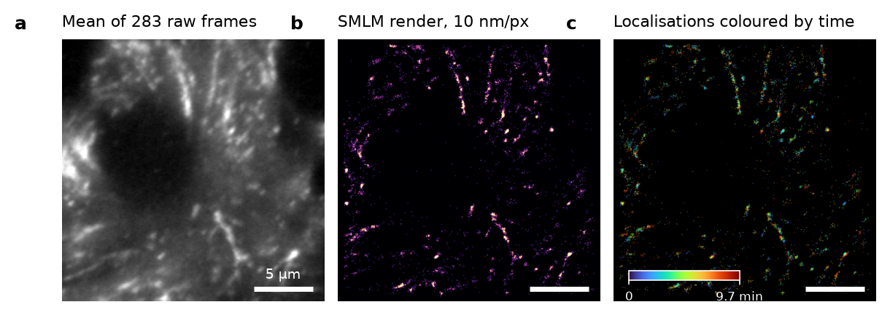

# Simple_SMLM_Localizer_2D_TIRF — SMLM Localization plugin for ImageJ / Fiji

Single-molecule localisation for sparse-emitter fluorescence time series (live-cell TIRF, PALM, STORM, PAINT):
difference-of-Gaussians detection, least-squares 2D Gaussian fitting, optional residual-drift correction from the
localisations, and super-resolution rendering. It uses ImageJ core only (no dependencies) and works on plain stacks
and hyperstacks.

Every spatial parameter is set in **nanometres** and converted with the pixel size, so recordings made at different
magnifications are analysed identically. The defaults are the parameters of the analysis in the accompanying
manuscript (see [Citation](#citation)); the plugin reproduces that analysis (see [Validation](#validation)).



*Sample data (included): GFP-talin in a living cell, pulsed-TIRF, 283 frames over 10 min. (a) Mean of all raw frames.
(b) The plugin's 10 nm/px render of the 6,330 localisations (displayed with a 2-pixel blur). (c) The same
localisations coloured by acquisition time; adhesions that moved during the recording show a colour gradient.
Scale bars 5 µm.*

## Features

- **Parameters in nm** — DoG filter, candidate separation, fit window and σ acceptance gate are defined in nm; the
  pixel equivalents are derived and written to the Log, so 107 nm and 160 nm data need no manual re-tuning.
- **Robust detection** — threshold at k × robust standard deviation (1.4826 × MAD) of the band-passed frame, which
  adapts to each frame's noise level.
- **Bounded least-squares fit** of a symmetric 2D Gaussian plus constant background (Levenberg–Marquardt with box
  constraints on position, σ, amplitude and background).
- **ThunderSTORM-compatible output** — the results table uses ThunderSTORM column names and its coordinate
  convention, so the CSV can be imported there for filtering, merging or rendering.
- **Honest units** — intensities stay in camera units (ADU) unless you enter the photon conversion; the localisation
  uncertainty (Mortensen et al. 2010, with EMCCD excess noise) is reported only when it can be calibrated.
- **Optional** residual-drift correction from the localisations, a density render (default 10 nm/px), and a
  time-binned render stack for *Image › Hyperstacks › Temporal-Color Code*.
- **Macro-recordable and headless** — every parameter is a macro key; *Save_CSV* writes the table and renders to disk
  for batch processing.
- Compiled for **Java 8**, so it runs in older and current Fiji. A Groovy script with the same code is provided for
  use without installing a jar.

## Installation

Two equivalent implementations are provided; use either.

**Jar plugin (recommended)**

1. Download `SMLM_Localization.jar` (from this repository or the latest
   [release](https://github.com/evildna/Simple_SMLM_Localizer_2D_TIRF/releases)) into `Fiji.app/plugins/`.
2. Restart Fiji.

The command appears under **Plugins › SMLM › SMLM Localization…**

**Groovy script (no installation of a jar)**

Copy `SMLM_Localization_Fiji.groovy` into `Fiji.app/plugins/Scripts/Plugins/` and restart Fiji (menu
*Plugins › SMLM Localization Fiji*), or open it in the Script Editor and press *Run*. The script is generated from the
Java source by `build.sh` and gives identical results (see [Validation](#validation)).

## Usage

1. Open a time series: a hyperstack with frames, or a plain stack (slices are then treated as time points). For
   z-stacks the central slice is used. If stage drift is present, correct it first, for example with the
   [Drift Correction plugin](https://github.com/evildna/DriftCorrectionForSMLMImageJPlugin).
2. Run *Plugins › SMLM › SMLM Localization…*. The pixel size is taken from the image calibration — **check it**: on
   some microscopes the recorded value does not include an intermediate magnification lens.
3. Set the parameters:

| Parameter | Default | Meaning |
|---|---|---|
| Channel | 1 | Channel to analyse |
| Pixel_size (nm) | from calibration | Camera pixel size in the specimen plane |
| DoG_sigma1 / DoG_sigma2 (nm) | 107 / 268 | Difference-of-Gaussians band-pass |
| Threshold (k × robust SD) | 4 | Candidate threshold on the filtered frame |
| Min_separation (nm) | 321 | Candidates are maxima within a (2m+1)² neighbourhood, m = round(value / pixel) |
| Fit_window (nm) | 960 | Fit window (2r+1)², r = round(value / pixel / 2), at least 2 |
| Sigma_min / Sigma_max (nm) | 86 / 235 | Accepted range of the fitted PSF σ |
| Camera_offset (ADU) | 0 | Camera baseline; used only for the background in photons |
| Photons_per_ADU | 0 | Photon conversion (e⁻/ADU ÷ EM gain); 0 = keep ADU, no uncertainty column |
| EMCCD | on | Excess-noise factor 2 in the uncertainty |
| Drift_correction | off | Residual-drift correction from the localisations |
| Drift_segment (frames) | 25 | Frames per localisation histogram for the drift estimate |
| Drift_upsampling | 2 | Histogram bin = camera pixel ÷ this factor |
| Render | on | Density render |
| Render_pixel / Render_blur (nm) | 10 / 15 | Render pixel size and Gaussian blur |
| Time_bins | 0 | Number of time-binned renders (0 = none); memory = bins × render size |
| Save_CSV | empty | Path of the results CSV; renders are saved next to it as TIFF |

Pixel equivalents of the defaults:

| | 107 nm/px | 160 nm/px |
|---|---|---|
| DoG σ | 1.00 / 2.50 px | 0.67 / 1.68 px |
| Candidate neighbourhood | 7 × 7 px | 5 × 5 px |
| Fit window | 9 × 9 px (0.96 µm) | 7 × 7 px (1.12 µm) |
| σ gate | 0.80–2.20 px | 0.54–1.47 px |

4. The Log window reports the parameters used, the derived pixel values and the number of localisations, e.g.
   `6330 localisations in 283 frames (22.4 per frame), 4.8 s`.

### Output

A results table `Localizations_<image>` with one row per localisation (*File › Save As…* writes CSV):

| Column | Content |
|---|---|
| `id`, `frame` | Running number; frame (1-based) |
| `t [s]` | (frame − 1) × frame interval, if the image has a frame interval; see notes |
| `x [nm]`, `y [nm]` | Position; the top-left corner of the image is 0 nm (ThunderSTORM convention) |
| `sigma [nm]` | Fitted PSF σ |
| `intensity [ADU]` or `[photon]` | Integrated spot intensity 2πAσ² |
| `offset [ADU]` or `[photon]` | Fitted local background per pixel (photons: after subtracting the camera offset) |
| `uncertainty [nm]` | Localisation uncertainty; only when Photons_per_ADU is set |
| `chi2` | Residual sum of squares of the fit ÷ (pixels − 5) |
| `drift_x [nm]`, `drift_y [nm]` | Correction applied, if drift correction was on |

and a 32-bit render `<image>_SMLM_10nm` (calibrated in nm), plus the time-binned stack if requested.

### Macro

```javascript
// keys = first word of each dialog label, lower case; checkboxes are on if the key is present
run("SMLM Localization...", "channel=1 pixel_size=107 dog_sigma1=107 dog_sigma2=268 threshold=4 " +
    "min_separation=321 fit_window=960 sigma_min=86 sigma_max=235 camera_offset=0 photons_per_adu=0 emccd " +
    "render render_pixel=10 render_blur=15 time_bins=0 save_csv=[/path/to/localisations.csv]");
```

[`macros/batch_localize.ijm`](macros/batch_localize.ijm) processes every TIFF in a folder. Headless:

```bash
ImageJ-<platform> --headless --console -macro macros/batch_localize.ijm "/path/to/input/,/path/to/output/,107"
```

## Algorithm

For every time point of the selected channel:

1. **Band-pass** — difference of two Gaussian filters (σ₁, σ₂; kernel truncated at 4σ, mirrored borders).
2. **Candidates** — pixels of the filtered image above k × 1.4826 × MAD (median absolute deviation of the filtered
   image) that are the maximum of their (2m+1)² neighbourhood; candidates closer than r + 1 pixels to the border
   are skipped.
3. **Fit** — A·exp(−((x−x₀)² + (y−y₀)²) / 2σ²) + b in the (2r+1)² window of the raw frame by Levenberg–Marquardt with
   box constraints: |x₀|, |y₀| ≤ 2 px from the candidate, σ in [64, 428] nm, A ≥ 0, b ≥ 0; start values b = 20th
   percentile of the window, A = maximum − b, σ = 139 nm.
4. **Accept** if A > 0 and σ lies strictly inside the σ gate. Dense structures that fit as wide blobs are rejected on
   purpose: the method assumes isolated emitters.
5. **Photons and uncertainty** (optional) — N = 2πAσ² × photons/ADU; uncertainty from Mortensen et al. (2010) with
   the pixelation term, × √2 for EMCCD.
6. **Residual-drift correction** (optional) — localisations of successive segments are binned into histograms
   (Drift_upsampling × camera resolution, blurred by 1 bin) and cross-correlated with the first segment (FHT,
   parabolic sub-pixel peak). The sign is verified by re-correlating the most-shifted segment after applying ± the
   shift. Shifts are assigned to segment centres, interpolated linearly to frames and added to x, y.
7. **Render** — localisation histogram at the render pixel size, Gaussian blur.

## Validation

**Synthetic data** (JUnit tests in `src/test`, run on every build): 81 emitters with a 130 nm PSF, 1500 photons, 20
background photons per pixel, Poisson and read noise.

| | 107 nm/px | 160 nm/px |
|---|---|---|
| Recall / false positives | 100 % / 0 | 100 % / 0 |
| Position RMSE vs ground truth | 7.5 nm | 6.9 nm |
| Mean fitted σ (true 130 nm) | 133.0 nm | 138.4 nm |

An imposed linear drift (+300 nm in x, −200 nm in y over 100 frames) is recovered with the correct sign (correction at
frame 95: −269 nm and +179 nm, expected −274 nm and +183 nm).

**Agreement with the analysis of the manuscript** (Python reference implementation: SciPy `gaussian_filter`,
scikit-image `peak_local_max`, SciPy `least_squares`), same input, default parameters:

| | Cell 1, full field (512 × 512 px, 283 frames) | Sample data (208 × 208 px, 283 frames) |
|---|---|---|
| Localisations, Python / plugin | 32,137 / 32,139 | 6,332 / 6,330 |
| Same localisation (< 0.05 px) | 99.82 % | 99.87 % |
| Position difference, 99.9th percentile | 0.004 px (0.45 nm) | 0.003 px (0.33 nm) |
| Median σ, Python / plugin | 141.6 / 141.8 nm | 151.0 nm / 151.0 nm |
| Run time, Python / plugin (one core) | 124 s / 29 s | — / 4.8 s |

The few remaining differences are windows containing two overlapping spots, where the two optimisers settle in
different local minima.

## Sample data

`sample_data/sample_GFPtalin_cell1_driftcorr_crop208.tif` — single-channel pulsed-TIRF time series of GFP-talin in a
living cell, already drift-corrected:

| | |
|---|---|
| Size | 208 × 208 px, 283 frames, 16-bit, uncompressed (24.5 MB) |
| Pixel size | 0.107 µm (field 22.3 µm) |
| Timing | 599 s; frame interval median 2.07 s, mean 2.12 s (calibration: 2.1232 s); exact times in `sample_frame_timestamps.csv` |
| Acquisition | Nikon Ti-E N-STORM, HP Apo TIRF 100×/1.49, 1.5× intermediate lens, Photometrics Evolve Delta EMCCD (EM gain 400), 200 ms exposure, 488 nm picosecond supercontinuum excitation |
| Origin | GFP channel of cell 1 of the manuscript (two-channel 512 × 512 series), drift-corrected by phase cross-correlation, cropped at y 80–287, x 256–463 |

Open it with *File › Open*; it opens as a calibrated 283-frame hyperstack.

**Expected result** with default parameters: **6,330 localisations** (22.4 per frame), median σ 151 nm, localisation
rate in the last 20 frames 0.84 of the first 20, 4–5 s on a laptop.

Sample data © 2026 Xian Hu / University of Oslo, provided for testing and demonstrating this plugin.

## Notes and limitations

- **Pixel size.** All nm parameters depend on it; the plugin uses the image calibration, which can be wrong when an
  intermediate magnification lens is not recorded in the metadata.
- **Intensities are in ADU** unless Photons_per_ADU (e⁻ per ADU ÷ EM gain) is entered; the uncertainty column then
  appears. With uncalibrated data, use σ and the intensity only for relative comparisons.
- **Time column.** `t [s]` assumes a constant frame interval. For non-equidistant acquisitions, join the exact
  timestamps on `frame`.
- **Isolated emitters only.** There is no multi-emitter fitting; overlapping spots are either rejected by the σ gate or
  fitted as one.
- **Drift correction** uses the first segment as the reference (not redundant cross-correlation of all segment pairs)
  and needs at least two segments. It is meant for residual drift after image-based correction; for large drift
  correct the images first.
- **Memory.** A 10 nm render of a 512 × 512 px field at 107 nm/px is 5479 × 5479 px (120 MB, 32-bit); each time bin
  adds the same.
- 2D only; no astigmatism or 3D fitting.

## Building from source

```bash
./build.sh /Applications/Fiji.app     # javac and ij.jar of a local Fiji; also regenerates the Groovy script
```

or with Maven (`pom.xml`, parent `pom-scijava`): `mvn package` → `target/SMLM_Localization-1.0.0.jar` (runs the
tests). Edit only `src/main/java/.../SMLM_Localization.java`; `SMLM_Localization_Fiji.groovy` is generated from it.
The continuous-integration workflow builds with Maven, runs the tests and checks that the Groovy script is in sync.

## Tested with

- ImageJ 1.52d and 1.54g (Java 11, macOS): unit tests; the jar loaded from a plugins folder and run headless by macro
  on the sample data (identical CSV and render with both versions).
- Groovy script: Groovy 2.4.8 (Fiji 2018) and Groovy 4.0.24 (current Fiji); identical results to the jar on 30 frames
  of cell 1 (3,809 of 3,809 localisations).
- Not yet tested: the interactive dialog on a desktop, Windows and Linux, Java 21 Fiji, multi-channel and z-stack
  hyperstacks (handled by the code, but the sample is single-channel). Please report results via GitHub Issues.

## Related plugins

- [Nikon ND2 to OME-TIFF](https://github.com/evildna/Nikon-ND2-to-OMETIFF-ImageJ-plugin) — lossless conversion with
  full metadata.
- [Drift Correction for SMLM](https://github.com/evildna/DriftCorrectionForSMLMImageJPlugin) — image-based drift
  correction before localisation.

## Citation

If you use this plugin, please cite:

> Margadant F, Bakke O, Sheetz MP, Hu X. Hour-long live-cell TIRF imaging of GFP-talin at ensemble and
> single-molecule level with low-duty-cycle picosecond supercontinuum excitation. *(in review)*

and this repository (see [`CITATION.cff`](CITATION.cff)). The uncertainty formula is from Mortensen KI, Churchman LS,
Spudich JA, Flyvbjerg H. *Nat Methods* 2010;7:377–381.

## License

MIT — see [LICENSE](LICENSE). Copyright (c) 2026 Xian Hu / University of Oslo.
